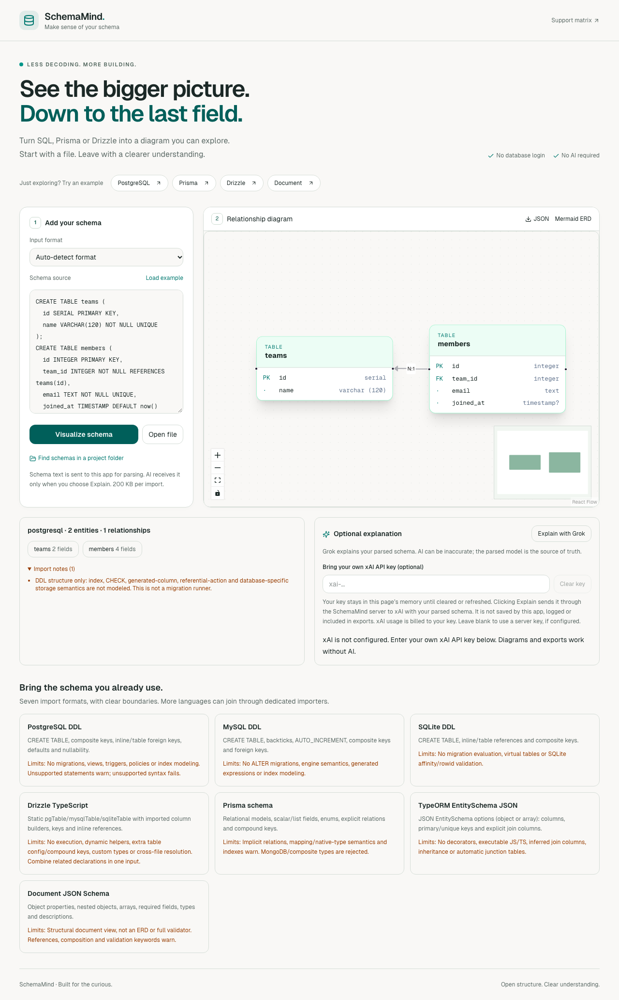

# SchemaMind

Explore database and ORM schema files without connecting to a live database. SchemaMind 0.2 turns supported definitions into interactive diagrams, field details and portable exports. Document schemas use a nested structure view rather than invented relational edges.

## Run locally

Requires Node.js **22.12+** (tested on 24) and npm. No AI or database credentials are needed.

```sh
npm ci
npm run dev
```

Open http://localhost:3000. For a production build: `npm run build && npm start`.

## Import workflow

- Paste a schema or open `.sql`, `.prisma`, `.ts`, `.js` or `.json` files.
- **Auto-detect** recognizes Prisma, Drizzle imports, TypeORM EntitySchema JSON and document JSON Schema. SQL-specific tokens can suggest PostgreSQL, MySQL or SQLite; shared/ambiguous SQL requires an explicit dialect choice. Detection is heuristic, with a manual override.
- **Find schemas in a project folder** lists likely schema files from a locally selected repository. It excludes `.git`, dependencies and build output; only a selected file is read. Up to 100 candidates are shown. Directory picking depends on browser support; Open file is the fallback.
- Click **Visualize schema**. Drag nodes, pan/zoom, select an entity, inspect fields and read import notes.
- Export the shared model as JSON, including warnings. Relational schemas also export Mermaid ERD with sanitized identifiers. Mermaid is a diagram, not a lossless SQL export; JSON preserves original names and compound keys.

This release does **not** connect to GitHub repositories, introspect running databases, run migration scripts, or execute uploaded JavaScript/TypeScript. Drizzle definitions split across files must be combined manually; imports are not followed. Choosing a local folder is file discovery, not a persistent repository grant.

## Tested support matrix

All importers produce the model in `lib/types/schema.ts`. Support is deliberately bounded; this is not universal database/ORM support.

| Input                     | Implemented and tested                                                                                                                                                                                                                                           | Exclusions / behavior                                                                                                                                                                                                                                                                                                                           |
| ------------------------- | ---------------------------------------------------------------------------------------------------------------------------------------------------------------------------------------------------------------------------------------------------------------- | ----------------------------------------------------------------------------------------------------------------------------------------------------------------------------------------------------------------------------------------------------------------------------------------------------------------------------------------------- |
| PostgreSQL DDL            | CREATE TABLE; qualified table names; scalar/array types; inline/table PK, UNIQUE and FK; compound keys/pairs; nullability and defaults                                                                                                                           | `pgsql-ast-parser` grammar subset. Other parsed statements warn and are omitted. ALTER migrations, inheritance expansion, indexes, CHECKs, views, triggers, policies, generated expressions and referential actions are not modeled. Unsupported syntax fails.                                                                                  |
| MySQL DDL                 | CREATE TABLE; backticks; AUTO_INCREMENT; nullability; defaults; inline/table and compound keys/FKs                                                                                                                                                               | MySQL grammar via `node-sql-parser`. No migration evaluation, engine/collation semantics, index/CHECK/generated-column modeling.                                                                                                                                                                                                                |
| SQLite DDL                | CREATE TABLE; INTEGER PK; inline/table references; compound keys and defaults                                                                                                                                                                                    | SQLite grammar via `node-sql-parser`. Not a SQLite validator; no affinity, virtual tables or rowid semantics. Non-INTEGER PK fields retain declared nullability.                                                                                                                                                                                |
| Prisma                    | Relational models; scalar/list fields; enum type names; single/compound keys; explicit relation fields and references; self/multiple targets                                                                                                                     | Navigation fields are not physical columns. Implicit relations warn and are omitted. Logical names shown; mappings/native attributes/indexes/actions are not modeled. MongoDB provider/composite types rejected. Enum values not modeled.                                                                                                       |
| Drizzle TypeScript        | Named (including aliased) imports from `drizzle-orm/pg-core`, `mysql-core`, `sqlite-core`; literal pgTable/mysqlTable/sqliteTable definitions; supported scalar builders; primaryKey/notNull/unique/default/array; inline references to tables in the same input | Parsed with TypeScript AST, never executed. Dynamic helpers/spreads, custom types, namespace imports, pgSchema, relations(), builder options, table config/compound keys/indexes and cross-file resolution are unsupported. Unsupported structures warn or fail when no entity is found. SQL aliases are not applied; property names are shown. |
| TypeORM EntitySchema JSON | Single options object or array; string column types; PK/UNIQUE and compound unique; explicit owning one-to-one/many-to-one join columns                                                                                                                          | Not decorators or executable JS. Join columns must exist explicitly. No inferred columns, automatic junction tables, inheritance, embedded entities, physical name mapping or index semantics.                                                                                                                                                  |
| Document JSON Schema      | Root properties; nested objects; arrays of objects/scalars; required versus nullable; type/description/default                                                                                                                                                   | Structural visualization, not validation. `$ref`, definitions, composition and validation keywords warn; no fetching external refs. No inferred FK/ERD. Not raw documents or MongoDB validator syntax.                                                                                                                                          |

Limits: 200 KB schema text, 150 entities, 3,000 fields, and 20 nested document levels. Invalid syntax, duplicates or missing foreign-key fields fail. Missing referenced entities warn and omit the edge. Warnings accompany every export, so partial support is visible.

## Optional AI

Only clicking **Explain with AI** sends the parsed model to Google Gemini. Set `GOOGLE_GENERATIVE_AI_API_KEY` on your server to enable it; never paste credentials into a schema. The response uses a single JSON contract rather than the old incompatible streaming protocols. Missing credentials, provider failures and timeouts leave diagrams and exports usable. No API key is required at build time. The previous gateway configuration is not supported in this release.

AI output is advisory. The model is the source of truth. A public deployment with AI enabled should apply its own access and usage controls before exposing a paid key; AI is disabled when no key is set.

## Verification

```sh
npm test
npm run typecheck
npm run build
npx playwright install chromium
npm run test:e2e
npm audit
```

Unit tests cover all importers, incorrect/ambiguous formats, compound key pairing, forward/self references, Prisma targets, document nesting, unsupported warnings, exports and file discovery. Browser tests exercise the production API, all sample inputs, file upload, dragging, details, downloads, AI absence, errors and mobile layout. Browser tests expect no Google API key and start a local production server on port 3100.

## Add an importer

Implement `(text: string) => Schema` in `lib/importers`, register it in `index.ts`, and add its format, sample and support limits in `catalog.ts`. Preserve keys as groups, reference pairs as arrays, and document fields as a tree. Emit warnings for every unsupported category; never silently guess links or claim validation. Add regression fixtures before expanding the support matrix.

## Revival decisions

Started from `main` at `260ee6e`, with a clean checkout. Reviewed PR #4 (security update to another canary) and PR #5 (frontend extraction retaining the wrong stream protocol). Neither was merged. Stable Next.js/React replace old canary/RC versions; the unused mixed AI SDKs and fake canned insights were removed. npm's committed lockfile is now authoritative. No deployment/DNS/access changes are bundled here.

## UI preview

The interface uses an original SchemaMind design, not the Cassava design skill. Desktop and mobile captures from the production-browser checks:



[Mobile workspace screenshot](docs/workspace-mobile.png)
